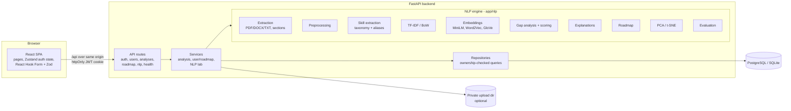
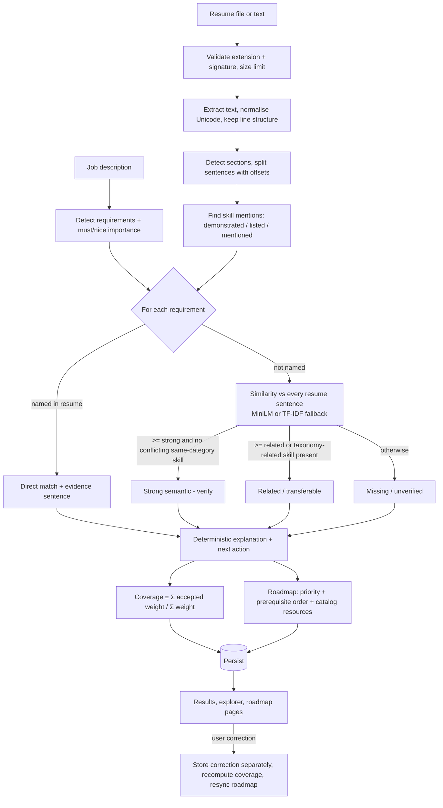

# Architecture

## System architecture



Layers have one-way dependencies: routes call services; services call the NLP engine and repositories;
the NLP engine has no web or database imports, so it can be tested and explained in isolation.

## Data-flow diagram (analysis)



## Entity-relationship diagram

```mermaid
erDiagram
  USERS ||--o{ RESUMES : owns
  USERS ||--o{ JOB_DESCRIPTIONS : owns
  USERS ||--o{ ANALYSES : owns
  USERS ||--o{ USER_FEEDBACK : gives
  RESUMES |o--o{ ANALYSES : "analysed in"
  JOB_DESCRIPTIONS |o--o{ ANALYSES : "analysed in"
  ANALYSES ||--o{ REQUIRED_SKILLS : has
  ANALYSES ||--o{ CANDIDATE_SKILLS : has
  ANALYSES ||--o{ EVIDENCE : has
  ANALYSES ||--o{ SKILL_MATCHES : has
  REQUIRED_SKILLS ||--|| SKILL_MATCHES : "classified by"
  EVIDENCE |o--o{ SKILL_MATCHES : supports
  ANALYSES ||--o| LEARNING_ROADMAPS : has
  LEARNING_ROADMAPS ||--o{ LEARNING_TASKS : contains
  LEARNING_TASKS ||--o{ LEARNING_PROGRESS : "status history"
  SKILL_MATCHES ||--o{ USER_FEEDBACK : "corrected by"

  USERS { int id PK; string email UK; string full_name; string password_hash; json preferences; datetime created_at }
  RESUMES { int id PK; int user_id FK; string file_type; string stored_path; text text; int char_count; json sections }
  JOB_DESCRIPTIONS { int id PK; int user_id FK; string title; text text }
  ANALYSES { int id PK; int user_id FK; int resume_id FK; int job_id FK; string mode; float coverage_score; float must_have_coverage; float doc_similarity_tfidf; float doc_similarity_semantic; json model_info; json extras }
  REQUIRED_SKILLS { int id PK; int analysis_id FK; string canonical; string category; string importance; float weight }
  CANDIDATE_SKILLS { int id PK; int analysis_id FK; string canonical; string strength }
  EVIDENCE { int id PK; int analysis_id FK; text sentence; string section; int start; int end; string kind }
  SKILL_MATCHES { int id PK; int required_skill_id FK; int evidence_id FK; string classification; string user_classification; float similarity }
  LEARNING_ROADMAPS { int id PK; int analysis_id FK }
  LEARNING_TASKS { int id PK; int roadmap_id FK; string skill; string priority; int order; string status; json resources }
  LEARNING_PROGRESS { int id PK; int task_id FK; string from_status; string to_status; datetime changed_at }
  USER_FEEDBACK { int id PK; int user_id FK; int match_id FK; string original_classification; string corrected_classification }
```

Full resume text is stored once (in `resumes`); evidence rows store only the supporting sentence and offsets.
Deleting an analysis cascades to its rows; its resume/job are removed if no other analysis uses them.
Deleting the user cascades to everything and removes stored files.

## Security model
- Passwords: scrypt (n=2^14, r=8, p=1), random salt, constant-time comparison.
- Sessions: HS256 JWT in an httpOnly, SameSite=Lax cookie (never in localStorage). Bearer header accepted for API clients.
- Every user-scoped query filters by `user_id`; foreign rows return 404 (no existence leak).
- Uploads: extension allow-list + magic-byte check, size cap enforced while reading, server-generated file names under a private directory (no traversal), originals not stored by default.
- Logging never includes resume or job text. Consistent JSON errors; unhandled errors return a generic message.
- No protected characteristics are inferred; contact details are detected only as present/absent and excluded from skill matching.
